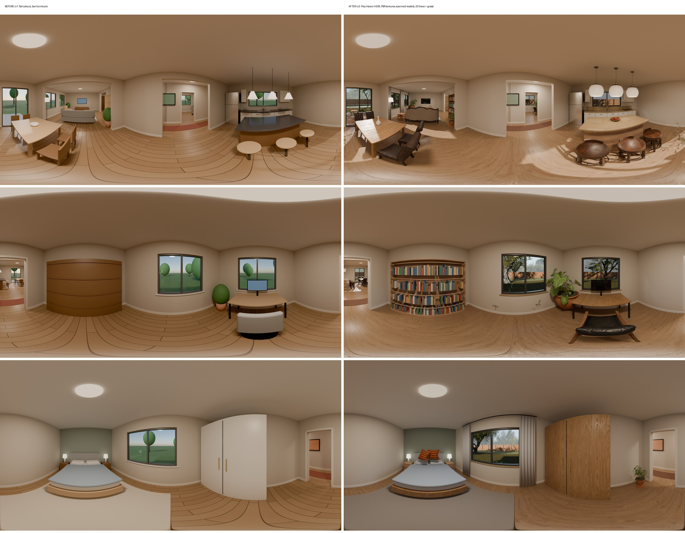

# Photoreal 360° walkthrough (prototype)

Street-View-style walkthrough of a simulated house: Blender **Cycles** renders an equirectangular
360° panorama at each viewpoint on **Modal** GPUs, and a **Pannellum** viewer links them with
floor arrows and a minimap.

Right now the house is a hard-coded mock (6 rooms, 8 viewpoints). It does not read the layout JSON
from [docs/CONTRACTS.md](../docs/CONTRACTS.md) yet. Wiring it to the solver output is the next step.



## How it works

`render_modal.py` runs the whole thing in one command:

1. **Assets.** Downloads free CC0 assets from Poly Haven (HDRI sky, PBR textures, scanned furniture,
   plants, trees, grass) into a Modal Volume `house-assets` once (~1.2 GB) and reuses them on later runs.
2. **Scene.** Builds walls, windows, doors, a floor, ceiling, curtains and furniture with `bpy`.
   The yard gets 3D trees, shrubs, a fence and grass scattered with geometry nodes.
3. **Lighting.** Uses the `meadow_2` HDRI. The script finds the sun in the image, rotates the sky so
   sunlight comes through the south windows, clamps the sun out of the HDRI and re-adds it as a sun
   lamp with matching energy. Window portals, warm interior lights, and compositor bloom plus
   distance haze finish it.
4. **Render.** Puts a panoramic (equirectangular) camera at each viewpoint at 1.6 m eye height and
   renders all viewpoints in parallel on L40S GPUs: 4096×2048, 640 samples with denoising, about
   2.7 min per room and roughly $1 for the whole house.
5. **Output.** Writes `panos/*.jpg` plus `tour.json`, which holds the viewpoints, the arrow
   direction (yaw) for each link, and the room rectangles for the minimap.

## Run

```bash
pip install modal && modal setup
modal run render_modal.py --test                         # 2 rooms, 1536 px, quick check
modal run render_modal.py --width 4096 --samples 640     # all 8 rooms (what's committed)
modal run render_modal.py                                # 8K + 4K copies, 512 samples
modal run render_modal.py --only living,kitchen          # re-render specific rooms
```

## View

```bash
python3 -m http.server 4391    # from this folder, then open http://127.0.0.1:4391
```

Drag to look around. Click the floor arrows or the minimap dots to walk between rooms.

## Conventions

- Units are metres, +Y = north. The panorama centre (yaw 0) faces +Y, and positive yaw turns toward +X.
- Poly Haven `.blend` files contain LOD copies, leaf/branch parts and geometry-node helpers. Nature
  assets keep only their LOD0 variants; furniture and props are imported whole.

## Next

- Read rooms, doors and windows from the solver's layout JSON instead of the mock house.
- Speed: fewer samples with GPU denoise, split each panorama across GPUs, warm containers, render the
  first room first and cache by layout hash. Target: first view in about 15 s, full house under 1 min.
- Depth-based parallax transitions between viewpoints.
